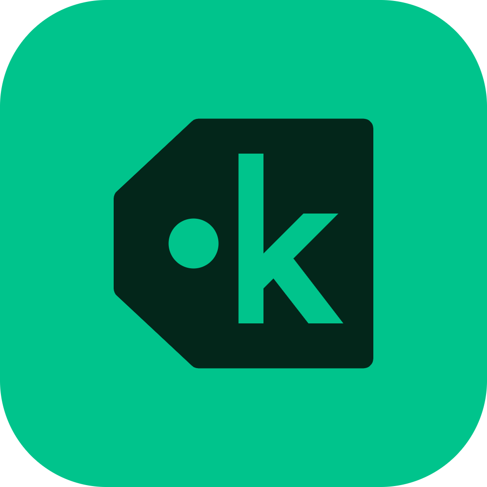
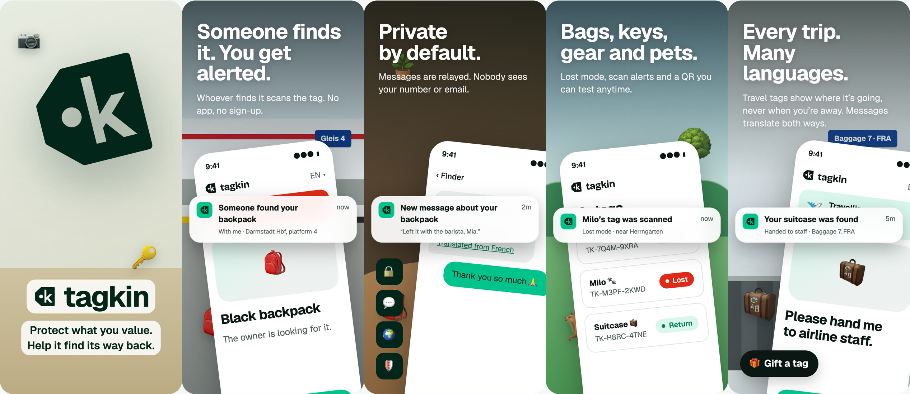
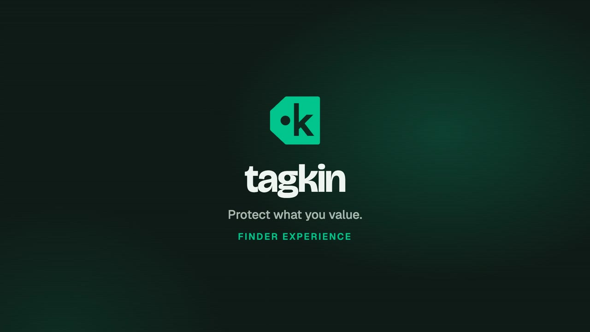

<p align="center"></p>

<h1 align="center">Tagkin</h1>

<p align="center"><b>Protect what you value.</b><br>QR tags for bags, keys, gear and pets. Whoever finds something scans the tag and alerts the owner, privately.</p>

<p align="center">
<a href="https://selasey-gbeddy.vercel.app/#story-tagkin"><b>Case study</b></a> &nbsp;·&nbsp;
<a href="https://prototype.tagkin.app"><b>Clickable prototype</b></a> &nbsp;·&nbsp;
<a href="https://github.com/users/Selaseyjr/projects/2"><b>Project board</b></a> &nbsp;·&nbsp;
<a href="https://www.figma.com/community/file/1705237136336735109/tagkin-qr-lost-and-found-app-design"><b>Figma</b></a>
</p>

<p align="center"></p>

A product owner and analyst case, end to end: problem, research, rules, journeys, a tested prototype and a build-ready backlog. Ready for engineering handover, with the product owner staying on.

## Watch it

| Owner experience · 1:32 | Finder experience · 1:01 |
| --- | --- |
| [](https://prototype.tagkin.app/media/tagkin-owner-experience.mp4) | [](https://prototype.tagkin.app/media/tagkin-finder-experience.mp4) |

## Read more

- **[Case study](https://selasey-gbeddy.vercel.app/#story-tagkin)** · the problem, research, decisions and what I delivered
- **[Project board](https://github.com/users/Selaseyjr/projects/2)** · phases, sprints and 70 user stories
- **Product documents** · [brief](docs/PRODUCT-BRIEF.md) · [business rules](docs/BUSINESS-RULES.md) · [user flows](docs/USER-FLOWS.md) · [system logic](docs/SYSTEM-LOGIC.md) · [roadmap](docs/ROADMAP.md) · [decisions](docs/adr/README.md)

<details>
<summary><b>Develop</b></summary>

Node 24 (see `.nvmrc`) and pnpm through Corepack.

```bash
fnm use            # or any Node version manager
corepack enable
pnpm install
pnpm check         # lint, typecheck, tests
pnpm build
supabase start     # local database with migrations and seed (Docker)
supabase test db   # database tests
```

| Path | What |
|---|---|
| `apps/web` | Next.js: finder pages, website, owner web, API routes |
| `apps/mobile` | Expo app for owners (bundle id `app.tagkin`, scheme `tagkin://`) |
| `packages/shared` | Rules shared everywhere: code alphabet, limits, shape fit, schemas |
| `packages/tokens` | Design tokens from `docs/brand/tokens.css` |
| `packages/i18n` | Core languages and translation files |
| `supabase/` | Migrations, seed data and database tests |

</details>
