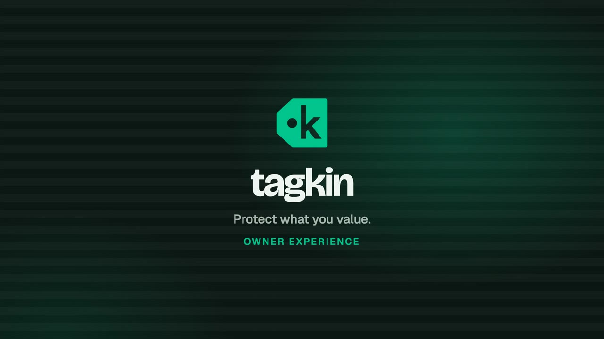

# Tagkin

**Protect what you value.** QR tags for bags, keys, gear and pets. Whoever finds something scans the tag and alerts the owner, privately. No app needed for finders.

Product owner and analyst work, end to end: from a real problem to a tested, clickable product and a build-ready specification. Ready for engineering handover, with the product owner staying on.

## Watch it

| Owner experience · 1:32 | Finder experience · 1:01 |
| --- | --- |
| [](https://prototype.tagkin.app/media/tagkin-owner-experience.mp4) | [](https://prototype.tagkin.app/media/tagkin-finder-experience.mp4) |
| Create and design a tag, sign in and order, lost mode, settings, the found alert | Scan, the owner's message, report, private reply, chat, safe handover |

## Try it

**[prototype.tagkin.app](https://prototype.tagkin.app)** · the owner app, the finder flow and desktop, fully clickable.

## What I delivered

| Step | Output |
| --- | --- |
| Problem and research | 3 user conversations; every theme became a product rule ([brief, section 15](docs/PRODUCT-BRIEF.md)) |
| Product definition | [Product brief](docs/PRODUCT-BRIEF.md) with a dated decision log · [Business rules](docs/BUSINESS-RULES.md) |
| Journeys and design | [User flows](docs/USER-FLOWS.md) · 68 owner screens, finder flow and desktop · design system in [docs/brand](docs/brand) |
| Testing | Finder flow tested with 5 people, owner app with 1 tester; each finding changed a rule or a screen |
| Specification | [System logic](docs/SYSTEM-LOGIC.md): data, states, events and providers |
| Backlog and delivery | 70 user stories in the [backlog](docs/BACKLOG.md) · [project board](https://github.com/users/Selaseyjr/projects/2) · [roadmap](docs/ROADMAP.md) with stage triggers |
| Technical design | [Tech design](docs/TECH-DESIGN.md) and 14 [decision records](docs/adr/README.md) |
| Quality | System and product [audits](docs/AUDIT-2026-11-12-system.md) with fixes · CI, database tests and a secret scan on every change |
| Foundation | Monorepo, database with row-level security, sign-in by email code, finder reports and owner replies |

Built with Claude Code, directed and reviewed by me: I set the specs and guardrails, reviewed every result as a user, and rejected work that didn't match.

## Key decisions

- **Private by default.** Messages are relayed; neither side sees the other's contact unless they choose to share it. Raised by a finder, not an owner.
- **No reward on the tag.** Research showed a public reward tempts people to keep things.
- **Three short steps for the finder:** where it is now, the exact place, an optional note.
- **Locked during a return.** Name, photo and description can't change while an item is out of the owner's hands.
- **A handover code** so the item goes back to the right person.

## Develop

Node 24 (see `.nvmrc`) and pnpm through Corepack.

```bash
fnm use            # or any Node version manager
corepack enable
pnpm install
pnpm check         # lint, typecheck, tests
pnpm build
supabase start     # local database with migrations and seed (Docker)
supabase test db   # database tests
```

| Path | What |
|---|---|
| `apps/web` | Next.js: finder pages, website, owner web, API routes |
| `apps/mobile` | Expo app for owners (bundle id `app.tagkin`, scheme `tagkin://`) |
| `packages/shared` | Rules shared everywhere: code alphabet, limits, shape fit, schemas |
| `packages/tokens` | Design tokens from `docs/brand/tokens.css` |
| `packages/i18n` | Core languages and translation files |
| `supabase/` | Migrations, seed data and database tests |
