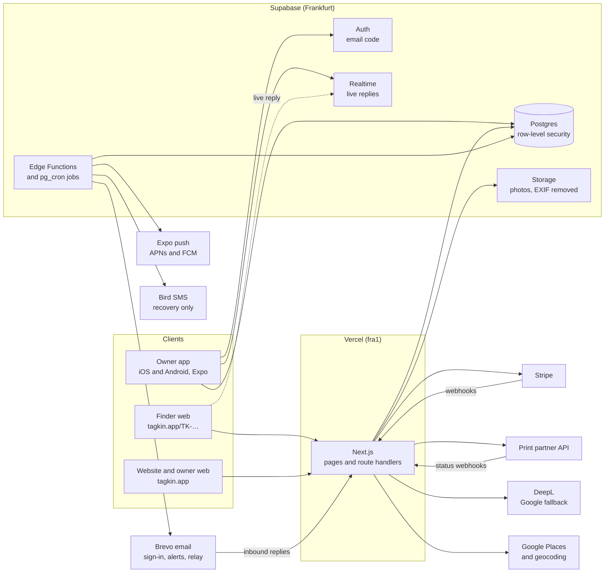

# Tagkin: technical design

Step 6 of the product owner flow. How Tagkin will be built. Inputs: BUSINESS-RULES.md (what must be true), SYSTEM-LOGIC.md (behaviour, data, states, events, requirements), BACKLOG.md (what to build). Decisions and their reasons: docs/adr/.

Version 1 · 11 Nov 2026.

## 1. Architecture



- **Finder web** is server-rendered by Next.js for speed. It never needs an account; it uses short-lived, per-report tokens to receive live replies.
- **Owner app and owner web** use Supabase Auth (email code) and talk to Postgres directly under row-level security, or through route handlers when a provider is involved.
- **Providers** are called only from the server side (route handlers, Edge Functions), never from clients with secret keys.
- **All personal data lives in Supabase (Frankfurt)**. Vercel and other providers receive only what each call needs; logs exclude personal data.

## 2. Repository

Monorepo (ADR 0011):

```
apps/mobile      Expo app (owner)
apps/web         Next.js: finder pages, website, owner web, route handlers
packages/shared  types, Zod schemas, state machines, constants (code alphabet, limits)
packages/tokens  design tokens generated from docs/brand/tokens.css
packages/i18n    translation files (core languages), RTL helpers
supabase/        migrations, row-level security policies, functions, seed data
```

CI (GitHub Actions): lint, type check, unit tests, migration check on every pull request; Vercel preview per pull request; EAS builds for the app. Pull requests reference stories ("Fixes #12"), so the board moves automatically.

## 3. Data and security

- Tables follow SYSTEM-LOGIC.md section 2: accounts, devices, tags, items, contacts, status_updates, scans, reports, returns, messages, orders, order_items, abuse_reports.
- **State machines** (tag, return, order, activation) are enforced in Postgres functions, so no client can skip a state.
- **Row-level security**: owners read and write only their own rows; finders act through server functions with a per-report token; admin role for moderation.
- **Secrets**: activation PINs, handover codes and finder report tokens are hashed; finder contacts, recovery phone and message bodies encrypted at rest (pgsodium/Vault or application-level encryption).
- **Rate limits**: code lookups, PIN and code attempts, reports and messages, enforced in the route handlers (with a store such as Upstash in the EU, or Postgres counters).
- **Photos**: uploaded to a private bucket; an Edge Function removes EXIF and resizes before the owner can see them.

## 4. API outline

Most owner reads and writes go straight to Supabase under row-level security. The routes below are server endpoints in Next.js (or Edge Functions) where rules, providers or finders are involved.

**Finder (no account)**

| Method and path | Purpose | Story |
|---|---|---|
| GET `/{code}` | Finder page: tag state, item, translated message, banners (lost, test, travel, status) | TK-10 |
| POST `/api/lookup` | Typed code → redirect or error (rate-limited) | TK-11 |
| POST `/api/reports` | Create report (where now, place, location, note, reply channel); returns a report token | TK-12, 14, 15 |
| POST `/api/reports/{token}/photo` | Upload safe-place photo | TK-13 |
| GET `/api/reports/{token}/messages` (+ Realtime channel) | Live owner replies | TK-16 |
| POST `/api/reports/{token}/messages` | Finder reply | TK-16 |
| POST `/api/returns/{token}/handover-check` | Check handover code (rate-limited) | TK-17 |
| POST `/api/abuse` | Report a tag or message | TK-19 |
| POST `/api/places/suggest`, `/api/places/reverse` | Proxy to Places and geocoding (keys stay on the server) | TK-12 |

**Owner**

| Method and path | Purpose | Story |
|---|---|---|
| Supabase Auth: email code sign-in | Sign up, sign in on app and web | TK-1, 3 |
| POST `/api/recovery/start`, `/api/recovery/verify` | Recovery by SMS or backup email | TK-4 |
| Supabase tables: tags, items, contacts, status_updates | Create, edit, customise; locks enforced by database functions | TK-30 to 39 |
| RPC `mark_lost`, `mark_found`, `mark_returned`, `retire_tag` | State changes | TK-38, 40, 44 |
| RPC `start_test_mode` | 10-minute test scans | TK-36 |
| RPC `regenerate_handover_code` | Handover code | TK-43 |
| Supabase table: messages (+ Realtime) | Relayed chat; server translates and relays | TK-41 |
| POST `/api/orders` | Create order (own or gift), price calculation on the server | TK-50, 51, 60 |
| POST `/api/orders/{id}/pay` | Create Stripe payment for the chosen method | TK-52 |
| POST `/api/activate` | Activate unclaimed tag with PIN (rate-limited) | TK-62 |
| POST `/api/account/export`, `/api/account/delete` | Data export and deletion | TK-6, 7 |

**Webhooks and jobs**

| Endpoint or job | Purpose |
|---|---|
| POST `/api/webhooks/stripe` | Payment succeeded or failed → order state; tag live; send to partner |
| POST `/api/webhooks/print-partner` | Production, shipped, tracking, failure |
| POST `/api/webhooks/email-inbound` | Finder replies by email → message |
| pg_cron jobs | Close silent returns, backup contact alerts, expire status and trips, end test mode, retention, reconciliation (SYSTEM-LOGIC.md section 7) |

## 5. Environments

| Environment | Use | Data |
|---|---|---|
| Local | Development | Seed data only |
| Preview | Per pull request (Vercel) with a shared staging Supabase project | Test data |
| Staging | Before each release; TestFlight and Google internal testing | Test data, Stripe test mode |
| Production | Live | Real data, Frankfurt |

## 6. Build order

Matches the milestones in BACKLOG.md:

1. **Sprint 0:** monorepo, Supabase project (Frankfurt), migrations for the core tables, tokens package, CI, Vercel and EAS set up, EU email provider and Stripe test accounts.
2. **M1 Finder web and accounts:** finder pages and report flow, email-code sign-in, owner web dashboard, report alerts by email.
3. **M2 Owner app core:** app shell, tags, customise, free phone tag, Lost mode, relay chat with translation, push, jobs, states.
4. **M3 Ordering and payment:** Stripe, print partner adapter, order states and emails.
5. **M4 Gifting and activation:** gift orders, PIN, activation flow.
6. **M5 Launch readiness:** website and legal, languages, accessibility, moderation, analytics, store listings.

## 7. Open items before Sprint 0

- ADR 0005 Brevo: verify tagkin.app (SPF, DKIM, DMARC), test sign-in codes and inbound replies.
- ADR 0006 Bird and ADR 0008 Google Places: create accounts at Sprint 0; set billing alerts and quotas.
- ADR 0010 print partner: order samples (Selasey).
- Domain tagkin.app (by 15 Nov).
- Analytics and errors: PostHog Cloud EU and Sentry (Frankfurt storage) with the privacy rules in ADR 0012; write a tracking plan for the success measures in Sprint 0.
- Accounts needed: Supabase (paid plan before launch), Vercel, Expo, Stripe, Apple Developer (before TestFlight), Google Play Console (before internal testing).
