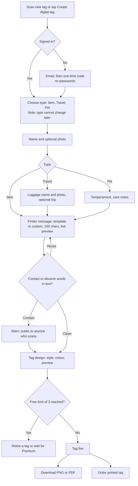
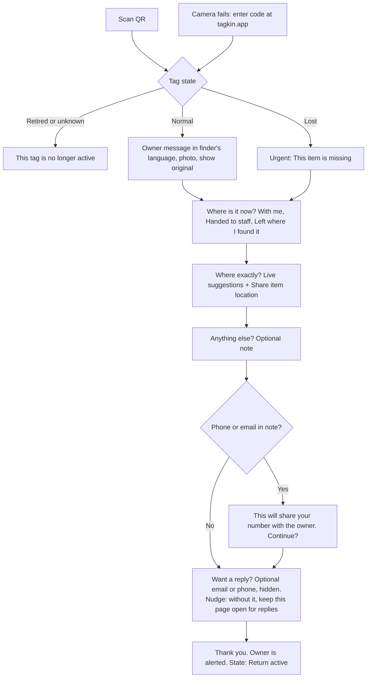
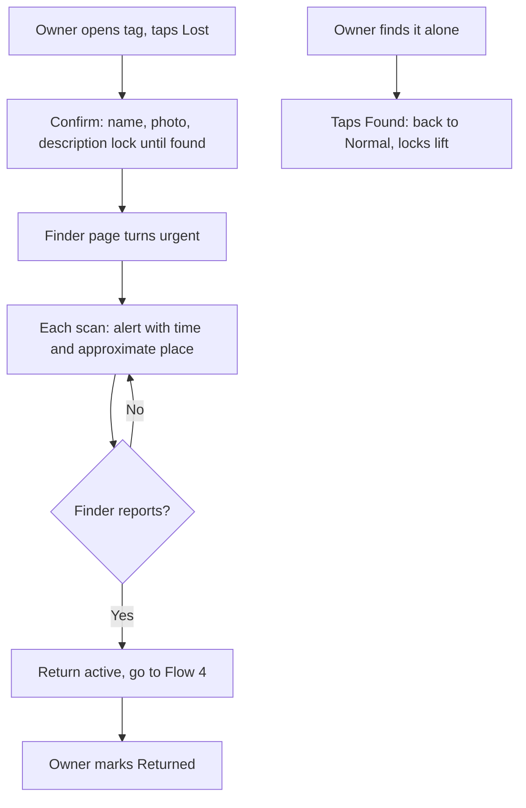
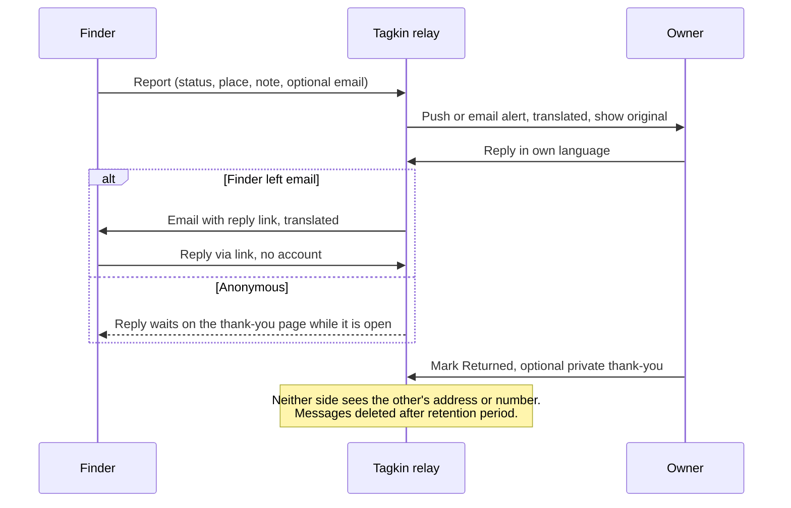

> **Superseded (11 Nov 2026).** This is the first draft of 8 Nov. Current flows: the flow map in docs/design/tagkin-screens.html, the prototypes, BUSINESS-RULES.md and SYSTEM-LOGIC.md. Changed since this draft, among others: Lost mode no longer locks details (only a return does); one free phone tag instead of 3; no PNG or PDF downloads; shapes follow the shape-fit table; blank tags; orders with a full lifecycle.

# Tagkin: user flows (MVP)

Phase 3, step 1. Scope: Item, Travel and Pet tags. Care tags are phase 2.
All flow decisions signed off on 8 Nov 2026 (brief section 14).

## Return states

A tag is always in one state. These drive the lock rules in brief section 7.

| State | Starts when | Locked | Ends when |
|---|---|---|---|
| Normal | Registration | Type, ID | Owner taps Lost, or a finder reports it |
| Lost | Owner taps Lost | + name, photo, description | Owner marks Found, or a finder reports it |
| Return active | First finder report | + name, photo, description | Owner marks Returned, or 14 days pass with no messages |
| Retired | Owner retires the tag | Everything; ID dead forever | Never |

## Flow 1: Owner registration

Screens: sign in, type, details, finder message, design, done. Privacy line on sign in: "Your contact is never shown. Finders message you through Tagkin."

## Flow 2: Finder

Target: under 10 seconds to the first tap, no app, no sign-up. Every screen shows "🔒 Your details stay private unless you choose to share them." Report abuse in the footer.

## Flow 3: Lost mode

No reward amount anywhere. After a return the owner can send a private thank-you.

## Flow 4: Messages (relay)

Safety: phone or email typed by either side triggers the share warning. Both sides can report abuse; the owner can block a finder thread.

## Decisions (8 Nov 2026)

1. Sign-in: email one-time code, no passwords.
2. A return ends when the owner marks Returned, or after 14 days with no messages.
3. Owner verification before handover: after the MVP.
4. Anonymous finders see replies only while the thank-you page is open; a gentle nudge suggests leaving an email.
5. Scan location: city level unless the finder shares exact location.
